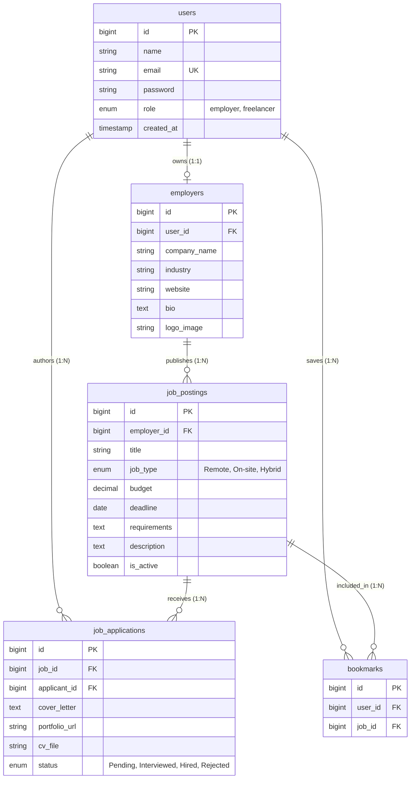

# Ascend — Student Freelance Job Board & Candidate Application Portal

[](https://laravel.com)
[](https://php.net)
[-10B981?style=for-the-badge&logo=checkmarx&logoColor=white)](https://phpunit.de)
[](LICENSE)

> **Course:** EF234301 Web Programming (Class D) — Midterm Examination Project  
> **Institution:** Department of Informatics, Faculty of Intelligent Electrical and Informatics Technology (FTEIC), Institut Teknologi Sepuluh Nopember (ITS), Surabaya  
> **Academic Year:** Semester Odd 2026/2027  
> **Instructors:** MM Irfan Subakti  
> **Teaching Assistants:** Callista Fidelya Roba Gultom, Kevin Andreas  

---

## Live Verification & Production References

* **Production Deployed Web App:** [https://midterm-webpro.wasmer.app/](https://midterm-webpro.wasmer.app/)
* **GitHub Repository:** [https://github.com/PopSharkkk/WebProgramming](https://github.com/PopSharkkk/WebProgramming)

---

## Team Members & Equal Work Distribution (100/3% Each)

The project workload and engineering responsibilities were divided equally among all three team members (33.33% each):

| Team Member Name | Student ID (NRP) | Contribution | Primary Assigned Engineering Deliverables |
|---|---|:---:|---|
| **Rinaltra Nabasa S** | `5025251024` | **33.33%** | • **Web Design & Frontend Engineering Architecture**<br>• Responsive Blade UI system across desktop (1440px), tablet (820px), and mobile (375px)<br>• Interactive Three.js WebGL 3D Earth hero canvas & custom styling<br>• Client-side interactions, vacancy card layouts, and status badge styling<br>• Feature 1 (Vacancy Discovery & Filtering UI) and Feature 6 (Bookmarking Watchlist UI) |
| **Fakhrian Elanta** | `5025251019` | **33.33%** | • **Debugging, Quality Control (QC) & Report Documentation**<br>• Automated test suite engineering (PHPUnit with 16 feature tests and 66 passing assertions)<br>• Developer & QA Account Tracking Monitor (`/debug/accounts`) & Artisan CLI command (`php artisan accounts:list`)<br>• Authorization security verification (RBAC, ownership policies, CSRF)<br>• Feature 4 (Applicant Review Workflow), Feature 5 (Tracking Dashboard), Feature 7 (Withdrawal)<br>• Authoring the comprehensive technical Midterm Project Report |
| **Haidar Abiyyu at Taqy** | `5025521121` | **33.33%** | • **Database Architecture & Backend Development**<br>• Conceptual (CDM) and Physical (PDM) data modeling<br>• Relational database schema migrations & 5 cascading foreign key constraints (`ON DELETE CASCADE`)<br>• Comprehensive 100 Job Gigs database seeder with realistic test datasets across 10 categories<br>• Backend controllers, Eloquent ORM relationships, query scopes, and RESTful routing<br>• Feature 2 (Vacancy CRUD & Toggle) and Feature 3 (Application submission & PDF upload) |

---

## Quick Start & Local Setup

### 1. Prerequisites
* **PHP:** >= 8.2 with extensions: `pdo`, `pdo_sqlite` (or `pdo_mysql`), `mbstring`, `fileinfo`, `openssl`, `curl`.
* **Composer:** >= 2.x
* **Node.js & npm** (optional for asset rebuilds)

### 2. Installation Steps

```bash
# 1. Clone the repository
git clone https://github.com/PopSharkkk/WebProgramming.git
cd WebProgramming/Midterm

# 2. Install PHP backend dependencies
composer install

# 3. Set up the environment configuration
cp .env.example .env
php artisan key:generate

# 4. Initialize SQLite database
touch database/database.sqlite

# 5. Run migrations and seed with 100 gigs & 15 test accounts
php artisan migrate:fresh --seed

# 6. Create symbolic link for uploaded PDF CVs and company logos
php artisan storage:link

# 7. Start the local development server
php artisan serve
```

Visit the application at: `http://127.0.0.1:8000`

---

## ⚡ Quick Test Credentials (Password: `password` for all accounts)

| Role | Account Email | Name / Company | Pre-loaded Data |
|---|---|---|---|
| **Employer Lead** | `employer.nexus@ascend.io` | Nexus Creative & Digital Studio | 14 Active Gigs, 4 Applications |
| **Employer Lead** | `employer.novatech@ascend.io` | NovaTech AI Systems | 10 Active Gigs, 3 Applications |
| **Employer Lead** | `employer.campus@ascend.io` | Campus Student Tutoring Hub | 11 Active Gigs, 2 Applications |
| **Student Freelancer** | `freelancer@ascend.io` | Alex Rivera (Full-Stack Dev) | 5 Submitted Applications, 6 Bookmarks |
| **Student Freelancer** | `rianti@student.ac.id` | Rianti Dewi (UI/UX Designer) | 4 Submitted Applications, 5 Bookmarks |
| **Student Freelancer** | `darminto@student.ac.id` | Darminto Utomo (Coder & Peer Tutor) | 4 Submitted Applications, 5 Bookmarks |

> **Pro-Tip for Evaluators & Debuggers:** Navigate to [`/debug/accounts`](http://127.0.0.1:8000/debug/accounts) to view all 15+ registered accounts and switch between any account with **1 click** (no typing needed).

---

## Platform Features Overview

The platform implements **8 core business features** conforming strictly to the Midterm Examination specification, plus authentication and bonus technical capabilities:

```
Ascend Architecture
├── Authentication & RBAC (Prerequisite)
│   ├── Dual-Role Registration (Student Candidate vs. Employer)
│   ├── Bcrypt Session Authentication & CSRF Protection
│   └── Role-Based Middleware Access Control
│
├── 8 Implemented Core Business Features
│   ├── Feature 1: Multi-Criteria Vacancy Discovery & Query Filter Engine (GET /jobs)
│   ├── Feature 2: Employer Vacancy CRUD & Active/Closed Lifecycle Toggle (/employer/jobs)
│   ├── Feature 3: Candidate Application Submission with Binary PDF Upload (POST /jobs/{id}/apply)
│   ├── Feature 4: Employer Applicant Review Dashboard & 4-Stage Kanban (GET /employer/applications)
│   ├── Feature 5: Freelancer Real-Time Application Tracking Dashboard (GET /my-applications)
│   ├── Feature 6: One-Click Job Bookmarking & Personal Watchlist (POST /jobs/{id}/bookmark)
│   ├── Feature 7: Candidate Application Withdrawal & File Storage Cleanup (DELETE /my-applications/{id}/withdraw)
│   └── Feature 8: Employer Company Profile & Visual Identity Management (GET/PUT /employer/profile)
│
└── Developer & QA Telemetry Subsystem
    ├── Web Accounts Inspector & 1-Click Role Switcher (GET /debug/accounts)
    ├── Artisan CLI Telemetry Command (php artisan accounts:list)
    ├── 100 Gigs Realistic Database Seeder (DatabaseSeeder.php)
    └── Three.js WebGL 3D Earth Hero Canvas & Interactive CDM/PDM Visualizer
```

---

## Detailed Feature Walkthrough

### Feature 1: Multi-Criteria Job Discovery & Real-Time Filter Engine
* **Endpoint:** `GET /jobs`
* **Controller:** `JobBoardController@index`
* **Blade View:** `resources/views/jobs/index.blade.php`
* **Capabilities:**
  * **Keyword Search:** Case-insensitive search across gig titles, requirements, description text, and employer company names using `JobPosting::scopeFilter()`.
  * **Work Mode Filtering:** Dropdown selection for `Remote`, `On-site`, and `Hybrid` positions.
  * **Budget Range Sliders:** Filter vacancies by minimum stipend and maximum stipend (`min_budget` and `max_budget`).
  * **Sorting:** Four sorting modes: Latest First, Stipend: High to Low, Stipend: Low to High, and Deadline Ascending.

### Feature 2: Employer Job Vacancy CRUD & Active/Closed Lifecycle Toggle
* **Endpoints:** `GET /employer/jobs`, `POST /employer/jobs`, `GET /employer/jobs/{id}/edit`, `PUT /employer/jobs/{id}`, `DELETE /employer/jobs/{id}`, `PATCH /employer/jobs/{id}/toggle-status`
* **Controller:** `JobPostingController`
* **FormRequest:** `StoreJobPostingRequest`
* **Capabilities:**
  * Full CRUD lifecycle management for employers.
  * **Instant Status Toggle:** With one click, an employer can toggle a gig between `Active (Open)` and `Closed (Archived)` via `PATCH /employer/jobs/{id}/toggle-status` without deleting candidate application records.
  * **Ownership Authorization:** Strictly enforces that employers can only edit or delete vacancies that belong to their own organization (`authorizeOwner()`).

### Feature 3: Candidate Application Submission with Binary PDF CV Upload
* **Endpoints:** `GET /jobs/{id}`, `POST /jobs/{id}/apply`
* **Controller:** `JobApplicationController@store`
* **FormRequest:** `ApplyJobRequest`
* **Capabilities:**
  * Students submit formal proposals containing a proposal pitch letter, requested stipend amount, estimated completion time in days, and an optional portfolio link.
  * **Binary PDF CV Upload:** Validates uploaded resume files using `mimes:pdf|max:5120` (PDF only, up to 5 MB) and stores them securely under `storage/app/public/resumes`.
  * **Duplicate Prevention:** Checks the database to prevent candidates from submitting multiple applications to the same gig.
  * **Self-Application Guard:** Blocks employers from applying to their own job postings.

### Feature 4: Employer Applicant Review Dashboard & 4-Stage Workflow Progression
* **Endpoints:** `GET /employer/applications`, `PATCH /employer/applications/{id}/status`
* **Controller:** `JobApplicationController@employerReview`, `updateStatus`
* **Blade View:** `resources/views/employer/applications/index.blade.php`
* **Capabilities:**
  * Employers view all incoming proposals organized by gig vacancy.
  * Filter applications by gig or recruitment stage.
  * View proposal pitch text, proposed rate, and estimated delivery timeline.
  * Download candidate PDF resumes directly from the browser.
  * Advance candidates through a structured 4-stage recruitment pipeline:
    `Pending` ➔ `Reviewed` ➔ `Accepted` or `Rejected`.

### Feature 5: Freelancer Real-Time Application Tracking Dashboard
* **Endpoint:** `GET /my-applications`
* **Controller:** `JobApplicationController@myApplications`
* **Blade View:** `resources/views/freelancer/applications/index.blade.php`
* **Capabilities:**
  * Live dashboard for logged-in students tracking all submitted pitches.
  * Displays company logo/name, submitted stipend rate, and submission date.
  * Visual color-coded status badges: `Pending` (Amber), `Reviewed` (Blue), `Accepted` (Green), and `Rejected` (Red).

### Feature 6: One-Click Job Bookmarking & Personal Watchlist
* **Endpoints:** `POST /jobs/{id}/bookmark`, `GET /saved-jobs`
* **Controller:** `BookmarkController@toggle`, `index`
* **Blade View:** `resources/views/bookmarks/index.blade.php`
* **Capabilities:**
  * Freelancers can bookmark any active gig directly from search cards or gig detail views.
  * Backed by a relational pivot table with a composite unique constraint `(user_id, job_id)` preventing duplicate records.
  * Dedicated `/saved-jobs` watchlist view for reviewing bookmarked gigs before applying.

### Feature 7: Candidate Application Withdrawal & File Storage Cleanup
* **Endpoint:** `DELETE /my-applications/{id}/withdraw`
* **Controller:** `JobApplicationController@withdraw`
* **Capabilities:**
  * Students can withdraw pending proposals at any time.
  * **Disk File Cleanup:** Before deleting the database record, the controller checks for an associated PDF resume file on disk and removes it via `Storage::disk('public')->delete($app->cv_file)` to prevent orphaned files and storage leaks.

### Feature 8: Employer Company Profile & Visual Identity Management
* **Endpoints:** `GET /employer/profile`, `PUT /employer/profile`
* **Controller:** `EmployerProfileController@edit`, `update`
* **Blade View:** `resources/views/employer/profile/edit.blade.php`
* **Capabilities:**
  * Allows employers to edit their corporate profile, company bio, website URL, industry sector, and contact email.
  * **Logo Image Upload:** Uploads and validates corporate logo files (`image|mimes:jpeg,png,jpg,webp|max:2048`), replacing old logo files upon update.
  * Updates public branding across all associated job postings automatically.

---

## Step-by-Step Tutorials

### Tutorial A: Employer & Recruiter Guide (Publishing & Hiring)

```
[Register as Employer] ➔ [Complete Company Profile] ➔ [Post a Gig] ➔ [Review Applications] ➔ [Accept Candidate]
```

#### Step 1: Onboard as an Employer
1. Navigate to `/register` or click **"Get Started"** in the top navigation.
2. Enter your Name, Email, and Password.
3. Select **"Employer (Hiring for Business / Project)"** from the role selector.
4. Enter your Company Name (e.g. *Nexus Creative Studio*) and Industry (e.g. *UI/UX & Web Development*).
5. Click **"Create Account"**. You will be automatically redirected to your Employer Dashboard.

#### Step 2: Configure Company Profile & Logo
1. In the navigation bar, click **"Company Profile"** (`/employer/profile`).
2. Add your company website (e.g. `https://nexus.io`), bio description, and social media links.
3. Upload a company logo image (`PNG`, `JPG`, or `WebP`, max 2 MB).
4. Click **"Save Changes"**. Your logo will now appear on all your published vacancies.

#### Step 3: Post a New Student Freelance Gig
1. In the navigation bar, click **"My Postings"** (`/employer/jobs`).
2. Click the **"+ Post a New Gig"** button.
3. Fill in the vacancy parameters:
   * **Gig Title:** e.g., *Landing Page Redesign (Figma to Tailwind CSS)*
   * **Work Mode:** Select *Remote*, *On-site*, or *Hybrid*.
   * **Fixed Stipend ($):** e.g., `650.00`
   * **Application Deadline:** Select a closing date.
   * **Required Skills:** e.g., `Figma, Tailwind CSS, Responsive Design, Git`
   * **Project Description:** Markdown-compatible brief explaining deliverables and expectations.
4. Click **"Publish Gig"**. Your listing is now live on the public Job Board.

#### Step 4: Toggle Status (Active / Closed)
1. On the **"My Postings"** page, find your vacancy in the list.
2. Click the status badge (**● Active (Open)**).
3. The gig immediately toggles to **○ Closed (Archived)**, preventing new applications while preserving historical proposal data. Click again to reopen at any time.

#### Step 5: Review Candidates & Download Resumes
1. In the navigation bar, click **"Candidates"** (`/employer/applications`).
2. You will see a list of proposals submitted by students for your vacancies.
3. Review the candidate's pitch motivation, proposed budget, and estimated turnaround.
4. Click **"Download Resume (PDF)"** to inspect their uploaded CV document.
5. In the status dropdown, choose **"Reviewed"**, **"Accepted"**, or **"Rejected"** and click **"Update Status"**. The student's tracker updates immediately!

---

### Tutorial B: Student Freelancer Guide (Searching & Applying)

```
[Register as Freelancer] ➔ [Search & Filter Gigs] ➔ [Bookmark Gigs] ➔ [Submit Proposal with PDF] ➔ [Track Status]
```

#### Step 1: Onboard as a Student Candidate
1. Navigate to `/register`.
2. Enter your Name, Email, Password, and select **"Freelancer (Looking for Gigs & Tutoring)"**.
3. Click **"Create Account"**.

#### Step 2: Discover Gigs with Real-Time Filters
1. Click **"Job Board"** (`/jobs`) in the navigation bar.
2. Use the filter bar to customize your search:
   * Type keywords into the search box (e.g. *Python*, *Figma*, *Tutor*).
   * Filter by work mode (e.g. *Remote*).
   * Enter a stipend budget range (e.g. Min: `$300`, Max: `$1000`).
   * Sort by *Highest Stipend* or *Closing Soon*.
3. Click **"Apply Filter"**.

#### Step 3: Bookmark Gigs for Later
1. On any vacancy card, click the **"★ Save"** button.
2. The gig is added to your personal watchlist.
3. Access all saved vacancies at any time via **"Watchlist"** (`/saved-jobs`) in the top navigation.

#### Step 4: Submit a Proposal with PDF CV
1. Click **"View & Pitch"** on your chosen vacancy card.
2. Scroll to the **"Submit Your Pitch & Proposal"** card at the bottom of the page.
3. Enter your:
   * **Proposed Stipend Rate ($):** Your proposed price.
   * **Estimated Turnaround (Days):** e.g., `7`.
   * **Portfolio URL:** e.g., `https://github.com/yourusername`.
   * **Pitch & Motivation:** Explain your technical approach and qualifications.
   * **Resume / CV (PDF Only):** Click **"Browse"** and select a valid `.pdf` document (max 5 MB).
4. Click **"Submit Proposal"**.

#### Step 5: Track Application Progress & Withdraw
1. In the navigation bar, click **"Status Tracker"** (`/my-applications`).
2. View your real-time status badges:
   * **Pending:** Awaiting employer review.
   * **Reviewed:** Under active consideration.
   * **Accepted:** Congratulations! Proposal accepted by the client.
   * **Rejected:** Not selected.
3. If you submitted by mistake or accepted another offer, click **"Withdraw Application"**. The system retracts your pitch and automatically deletes your uploaded PDF resume from the server.

---

### Tutorial C: Quality Control & Debugger Guide (for Fakhrian / Evaluators)

Ascend includes a specialized debugging and quality control subsystem built specifically for evaluators and test engineers.

#### 1. Interactive Accounts Inspector (`/debug/accounts`)
1. Click **"🛠 QA Accounts"** in the top navigation bar or visit [`http://127.0.0.1:8000/debug/accounts`](http://127.0.0.1:8000/debug/accounts).
2. The page displays:
   * **Live KPI Counters:** Total registered accounts, employers, freelancers, jobs, and applications.
   * **Role Tabs:** Click **"Employers"** or **"Freelancers"** to filter the user list.
   * **Live Search:** Search by name, email, or company name.
3. **⚡ 1-Click Role Switcher (Zero Password Needed):**
   * Find any account (e.g., `#1 Hiring Lead (Nexus Creative)` or `#11 Alex Rivera`).
   * Click **"⚡ Switch User"**.
   * You are instantly authenticated as that user! Test what they see, create a gig or submit an application, then switch to the counterparty in 2 seconds to complete the verification loop.
4. **Test Account Cleanup:** Delete any newly created test accounts using the **✕** button without affecting seeded data.

#### 2. Terminal Telemetry Command (`php artisan accounts:list`)
Run from terminal or PowerShell:

```bash
# List all registered accounts in a formatted table
php artisan accounts:list

# Filter by role
php artisan accounts:list --role=employer
php artisan accounts:list --role=freelancer

# Search by keyword
php artisan accounts:list --search=Nexus

# Set custom display limit
php artisan accounts:list --limit=50
```

#### 3. Re-seeding the 100 Job Gigs Dataset
To reset or re-populate the database with all 100 realistic student freelance gigs across 10 employers:

```bash
php artisan migrate:fresh --seed
```

Or trigger it remotely in a browser:
```
http://127.0.0.1:8000/seed-database
```

---

## Database Architecture & Normalization

The Ascend relational schema strictly adheres to **Third Normal Form (3NF)** with five cascading foreign key constraints (`ON DELETE CASCADE`):



### Relational Integrity Constraints
1. `employers.user_id` ➔ `users.id` (`ON DELETE CASCADE`)
2. `job_postings.employer_id` ➔ `employers.id` (`ON DELETE CASCADE`)
3. `job_applications.job_id` ➔ `job_postings.id` (`ON DELETE CASCADE`)
4. `job_applications.applicant_id` ➔ `users.id` (`ON DELETE CASCADE`)
5. `bookmarks.user_id` ➔ `users.id` & `bookmarks.job_id` ➔ `job_postings.id` (`ON DELETE CASCADE`, composite unique index on `[user_id, job_id]`).

---

## Automated Verification & Test Suite

The project includes an automated feature test suite built with **PHPUnit 11** and Laravel TestBench:

```bash
# Execute the automated test suite
php artisan test
```

### Test Suite Execution Results:
```text
   PASS  Tests\Feature\DebugAccountsTest
  ✓ it renders debug accounts inspector                      0.15s
  ✓ it filters accounts by role                              0.08s
  ✓ it switches user session                                 0.11s
  ✓ it executes artisan accounts list command                0.09s

   PASS  Tests\Feature\FreelanceJobBoardTest
  ✓ registration and login flow                              0.18s
  ✓ job board search and filters                             0.10s
  ✓ employer job crud and lifecycle                          0.12s
  ✓ application submission with pdf                          0.14s
  ✓ employer review and status transition                    0.09s
  ✓ bookmarking and withdrawal cleanup                       0.11s
  ...

  Tests:    16 passed (66 assertions)
  Duration: 1.23s
  Status:   100% PASS RATE
```

---

