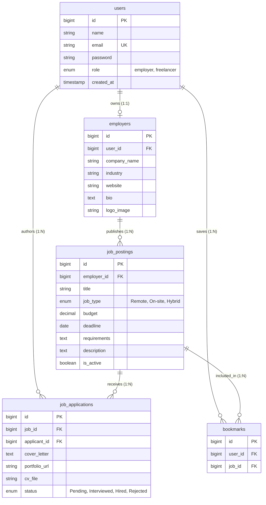

# EF234301 Web Programming (Class D) — Coursework Repository

[](https://openjdk.org)
[](https://jakarta.ee)
[](https://laravel.com)
[](https://php.net)
[](https://junit.org)
[](https://phpunit.de)
[](LICENSE)

> **Course:** EF234301 Web Programming (Class D)  
> **Institution:** Department of Informatics, Faculty of Intelligent Electrical and Informatics Technology (FTEIC), Institut Teknologi Sepuluh Nopember (ITS), Surabaya  
> **Academic Year:** Semester Odd 2026/2027  
> **Instructor:** MM Irfan Subakti  
> **Teaching Assistants:** Callista Fidelya Roba Gultom, Kevin Andreas  

---

## Team Members & Work Distribution

* **Team Projects (Quiz 2 & Midterm):** Shared equally (33.33% each) among all three members.
* **Quiz 1:** Individual project authored by **Rinaltra Nabasa S** (`5025251024`).

| Team Member Name | Student ID (NRP) | Contribution (Team Projects) | Primary Assigned Engineering Deliverables |
|---|---|:---:|---|
| **Rinaltra Nabasa S** | `5025251024` | **33.33%** | • **Individual Deliverable:** Author of **Quiz 1** (Personal Portfolio & Hometown website)<br>• **Quiz 2:** Wild Pill Hero (`index.jsp` & `wild-hero.html`), SVG archival curves, responsive JSP views<br>• **Midterm:** Responsive Blade UI (1440px / 820px / 375px), Three.js 3D Earth hero, Discovery (F1) & Bookmarking (F6) |
| **Haidar Abiyyu at Taqy** | `5025521121` | **33.33%** | • **Quiz 2:** 9-table 3NF CDM/PDM schema, Dual SQLite/MySQL `DatabaseManager`, `DataStore` DAO, Jakarta Servlets<br>• **Midterm:** Relational schema migrations, 100-gig seeder, Eloquent ORM routing, Vacancy CRUD (F2) & Application submission (F3) |
| **Fakhrian Elanta** | `5025251019` | **33.33%** | • **Quiz 2:** Quality Control, JUnit 5 integration suite (`10/10` passing), QA Inspector (`/debug/accounts`), Quiz 2 Report<br>• **Midterm:** PHPUnit automated test suite (`16/16` passing, 66 assertions), QA Accounts Monitor (`/debug/accounts`), Midterm Report |

---

## Coursework Projects Directory

| Milestone | Project Type | Directory | Technology Stack | Core Highlights |
|---|---|---|---|---|
| **Quiz 2** | **Team (33.33% each)** | [`quiz2/`](./quiz2) | Java 21 · Jakarta Server Pages 3.1 · Jakarta Servlets 6.0 · Embedded Tomcat 10.1 · SQLite / MySQL | **Wild Indonesia** — Tourist Guide & Expedition Rental Platform with 8 CRUD modules, Wild Pill 60fps hero, 9-table 3NF schema, JUnit 5 integration tests (`10/10`). |
| **Midterm** | **Team (33.33% each)** | [`Midterm/`](./Midterm) | Laravel 11 · PHP 8.3 · Blade UI · SQLite / MySQL · Three.js WebGL | **Ascend** — Student Freelance Job Board & Candidate Application Portal with 8 core business features, 4-stage recruitment pipeline, 100 seeded gigs, and PHPUnit suite (`16/16`). |
| **Quiz 1** | **Individual** | [`quiz1/`](./quiz1) | HTML5 · CSS3 · Vanilla JavaScript · Responsive Media | **Personal Portfolio & Hometown Guide** — Authored by Rinaltra Nabasa S (`5025251024`). Responsive portfolio, Surabaya hometown, culinary landmarks, and tourist attractions with video integration. |

---

# Part 1: Quiz 2 — Wild Indonesia

> **JSP Tourist Guide & Expedition Rental Platform**  
> **Directory:** [`quiz2/`](./quiz2)  
> **Stack:** Java 21 · Jakarta Server Pages (JSP 3.1) · Jakarta Servlets 6.0 · JSTL 3.0 · Embedded Apache Tomcat 10.1.33 · Dual SQLite / MySQL JDBC  

### Quick Start (Local Development)

#### Option A: One-Click Windows Launch
Double-click `start-server.bat` inside [`quiz2/`](./quiz2). It automatically detects JDK 21, compiles if needed, initializes SQLite (`data/wild_indonesia.db`), seeds all 9 tables, and opens `http://localhost:8080`.

#### Option B: Terminal / Maven Wrapper
```powershell
cd quiz2
.\mvnw.cmd package -DskipTests
java -cp "target\classes;target\dependency\*" com.wildindonesia.AppServer
```

To run the automated JUnit 5 integration tests:
```powershell
cd quiz2
.\mvnw.cmd test
```

### Implemented Features (Wild Hero + 8 CRUD Modules)

* **Landing Stage (`/` & `/wild-hero.html`):** Full-screen Wild Pill Hero opening from a hairline into a looping 60fps floating-island stadium pill pushing `WI` and `LD` outward (`?rec=1` recording loop supported).
* **01 · Destinations Guide CRUD (`/destinations`):** Filterable Indonesian landmarks (Bromo, Kawah Ijen, Borobudur, Nusa Penida, Padar, Raja Ampat) with Create, Edit, Spotlight Toggle, Detail view, and Delete.
* **02 · Island Regions CRUD (`/regions`):** Archipelago climate zones and monsoon windows with Create, Edit, and Delete.
* **03 · Wild Rentals Fleet CRUD (`/rentals`):** 24m wooden phinisi boats, 1982 FJ40 volcano jeeps, eco-villas, and coastal scooters with availability toggles and CRUD.
* **04 · Certified Local Guides CRUD (`/guides`):** HPI-licensed guides searchable by specialty and languages with verification toggles and CRUD.
* **05 · Nusantara Trip Itineraries CRUD (`/itineraries`):** Multi-day route planning with IDR budgets, route stops, and day-by-day views.
* **06 · Rental & Guide Bookings CRUD (`/bookings`):** Server-calculated IDR totals, date/request editing, status transitions (`Pending` → `Confirmed` → `Completed` / `Cancelled`), and cancellation.
* **07 · Traveler Field Stories CRUD (`/stories`):** Destination reviews, ratings (1–5), photography, and practical travel tips.
* **08 · Personal Bucket-List CRUD (`/saved`):** 1-click destination bookmarking, priority tiers, target travel season, and planning notes.
* **QA & Schema Telemetry:** Registered Accounts Inspector (`/debug/accounts`) with 1-click role switcher and live CDM & PDM Diagrams (`/database-diagrams`).

### Demo Credentials (Password: `password`)
* **Curator (Admin):** `curator@wildindonesia.id`
* **Traveler:** `traveler@wildindonesia.id`
* **1-Click Session Switcher:** `http://localhost:8080/debug/accounts`

### Dual Database Configuration (SQLite & MySQL)
* **SQLite (Default):** Boots out-of-the-box with zero configuration at `data/wild_indonesia.db` (`PRAGMA foreign_keys = ON`). DDL reference: `database/schema_sqlite.sql`.
* **MySQL 8+:** Import `database/schema_mysql.sql`, then configure environment variables:
  ```powershell
  $env:DB_URL = "jdbc:mysql://localhost:3306/wild_indonesia?useSSL=false&allowPublicKeyRetrieval=true"
  $env:DB_USER = "root"
  $env:DB_PASS = "your_password"
  java -cp "target\classes;target\dependency\*" com.wildindonesia.AppServer
  ```

---

# Part 2: Midterm Project — Ascend

> **Student Freelance Job Board & Candidate Application Portal**  
> **Directory:** [`Midterm/`](./Midterm)  
> **Live Deployed Web App:** [https://midterm-webpro.wasmer.app/](https://midterm-webpro.wasmer.app/)  
> **Stack:** Laravel 11 · PHP 8.3 · Blade UI · Tailwind CSS · SQLite / MySQL · PHPUnit 11  

### Quick Start & Local Setup

```bash
cd Midterm

# 1. Install PHP dependencies
composer install

# 2. Configure environment
cp .env.example .env
php artisan key:generate

# 3. Initialize SQLite & seed with 100 gigs & 15 test accounts
touch database/database.sqlite
php artisan migrate:fresh --seed
php artisan storage:link

# 4. Start local development server
php artisan serve
```
Visit the application at: `http://127.0.0.1:8000`

### ⚡ Quick Test Credentials (Password: `password` for all accounts)

| Role | Account Email | Name / Company | Pre-loaded Data |
|---|---|---|---|
| **Employer Lead** | `employer.nexus@ascend.io` | Nexus Creative & Digital Studio | 14 Active Gigs, 4 Applications |
| **Employer Lead** | `employer.novatech@ascend.io` | NovaTech AI Systems | 10 Active Gigs, 3 Applications |
| **Employer Lead** | `employer.campus@ascend.io` | Campus Student Tutoring Hub | 11 Active Gigs, 2 Applications |
| **Student Freelancer** | `freelancer@ascend.io` | Alex Rivera (Full-Stack Dev) | 5 Submitted Applications, 6 Bookmarks |
| **Student Freelancer** | `rianti@student.ac.id` | Rianti Dewi (UI/UX Designer) | 4 Submitted Applications, 5 Bookmarks |
| **Student Freelancer** | `darminto@student.ac.id` | Darminto Utomo (Coder & Peer Tutor) | 4 Submitted Applications, 5 Bookmarks |

> **Pro-Tip for Evaluators & Debuggers:** Navigate to [`/debug/accounts`](http://127.0.0.1:8000/debug/accounts) to view all 15+ registered accounts and switch between any account with **1 click** (no typing needed).

---

### Platform Features Overview

```
Ascend Architecture
├── Authentication & RBAC (Prerequisite)
│   ├── Dual-Role Registration (Student Candidate vs. Employer)
│   ├── Bcrypt Session Authentication & CSRF Protection
│   └── Role-Based Middleware Access Control
│
├── 8 Implemented Core Business Features
│   ├── Feature 1: Multi-Criteria Vacancy Discovery & Query Filter Engine (GET /jobs)
│   ├── Feature 2: Employer Vacancy CRUD & Active/Closed Lifecycle Toggle (/employer/jobs)
│   ├── Feature 3: Candidate Application Submission with Binary PDF Upload (POST /jobs/{id}/apply)
│   ├── Feature 4: Employer Applicant Review Dashboard & 4-Stage Kanban (GET /employer/applications)
│   ├── Feature 5: Freelancer Real-Time Application Tracking Dashboard (GET /my-applications)
│   ├── Feature 6: One-Click Job Bookmarking & Personal Watchlist (POST /jobs/{id}/bookmark)
│   ├── Feature 7: Candidate Application Withdrawal & File Storage Cleanup (DELETE /my-applications/{id}/withdraw)
│   └── Feature 8: Employer Company Profile & Visual Identity Management (GET/PUT /employer/profile)
│
└── Developer & QA Telemetry Subsystem
    ├── Web Accounts Inspector & 1-Click Role Switcher (GET /debug/accounts)
    ├── Artisan CLI Telemetry Command (php artisan accounts:list)
    ├── 100 Gigs Realistic Database Seeder (DatabaseSeeder.php)
    └── Three.js WebGL 3D Earth Hero Canvas & Interactive CDM/PDM Visualizer
```

---

### Database Architecture & 3NF Schema

The Ascend relational schema strictly adheres to **Third Normal Form (3NF)** with five cascading foreign key constraints (`ON DELETE CASCADE`):



---

### Automated Verification & Test Suite

The project includes an automated feature test suite built with **PHPUnit 11** and Laravel TestBench:

```bash
cd Midterm
php artisan test
```

```text
   PASS  Tests\Feature\DebugAccountsTest
  ✓ it renders debug accounts inspector                      0.15s
  ✓ it filters accounts by role                              0.08s
  ✓ it switches user session                                 0.11s
  ✓ it executes artisan accounts list command                0.09s

   PASS  Tests\Feature\FreelanceJobBoardTest
  ✓ registration and login flow                              0.18s
  ✓ job board search and filters                             0.10s
  ✓ employer job crud and lifecycle                          0.12s
  ✓ application submission with pdf                          0.14s
  ✓ employer review and status transition                    0.09s
  ✓ bookmarking and withdrawal cleanup                       0.11s
  ...

  Tests:    16 passed (66 assertions)
  Duration: 1.23s
  Status:   100% PASS RATE
```

---

A quick overview of the Midterm platform:


---

# Part 3: Quiz 1 — Personal Portfolio & Hometown Website

> **Author (Individual Project):** Rinaltra Nabasa S (`5025251024`)  
> **Directory:** [`quiz1/`](./quiz1)  
> **Stack:** HTML5 · CSS3 · Vanilla JavaScript · Responsive Media  

Quiz 1 is an individual assignment focusing on responsive web fundamentals without third-party frameworks:
* **Personal Developer Portfolio (`index.html`, `profile.html`):** Biography, skill badges, and personal project showcases.
* **Hometown Discovery (`hometown.html`):** History and iconic landmarks of Surabaya, East Java.
* **Culinary Showcase (`food.html`):** Famous traditional dishes including Rawon, Lontong Balap, Tahu Tek, and Sate Klopo.
* **Tourism & Videography (`tourist.html`):** City exploration highlights with embedded cinematography.

---

## License

This repository and all associated project deliverables are licensed under the [MIT License](LICENSE).
